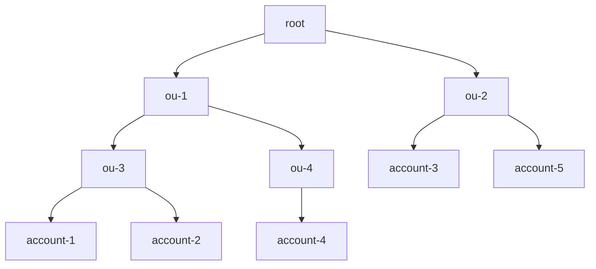

# AWS CloudFormation Construct Library


This module is part of the [AWS Cloud Development Kit](https://github.com/aws/aws-cdk) project.

## StackSets

The `StackSet` construct allows you to define [AWS CloudFormation StackSets](https://docs.aws.amazon.com/AWSCloudFormation/latest/UserGuide/what-is-cfnstacksets.html).
A `StackSet` is a stack: the resources you define in it make up the template that the StackSet deploys
to the target accounts and regions. Like a `NestedStack`, it is defined within another stack, which
deploys the StackSet.

```ts
class MyStackSet extends StackSet {
  constructor(scope: Construct, id: string, props: StackSetProps) {
    super(scope, id, props);

    new iam.Role(this, 'MyRole', {
      assumedBy: new iam.ServicePrincipal('myservice.amazonaws.com'),
    });
  }
}

const app = new App();
const stack = new Stack(app, 'Admin');

new MyStackSet(stack, 'MyStackSet', {
  targets: [StackSetTarget.fromAccounts({
    regions: ['us-east-1'],
    accounts: ['111111111111'],
    parameterOverrides: {
      SomeParam: 'overrideValue',
    },
  })],
});
```

A `StackSet` has a couple of special requirements and behaviors compared to a `Stack`:

*Requirements*
- Must be defined within the scope of a `Stack` (directly, through other constructs, or in a `NestedStack`).
  That stack contains the `AWS::CloudFormation::StackSet` resource, its administration role, and
  uploads the template and its file assets. They are created next to the StackSet, with its ID as a
  prefix (for example `MyStackSet.Resource`, which is also `stackSet.node.defaultChild`)

*Behavior*
- The resources of a `StackSet` are deployed to every account and region it targets, so the StackSet is
  always environment agnostic, even if its containing `Stack` has an environment: `stackSet.account`
  and `stackSet.region` resolve to the account and region of each stack instance (`AWS::AccountId` and
  `AWS::Region`). `stackSet.env` and `stackSet.stack` describe the `AWS::CloudFormation::StackSet`
  resource, which is deployed by its containing `Stack`.
- The template is not deployed directly by CDK tooling, only as part of another stack's deployment
- Values from other stacks that the template references are passed to it as StackSet parameters, the
  same way a `NestedStack` gets values from its parent
- Other stacks can't reference the resources of a `StackSet`, because its template is deployed to many
  accounts and regions
- The `description` is the description of the StackSet resource. Set the description of its template
  with `stackSet.templateOptions.description`
- Tags of the StackSet (`Tags.of(stackSet).add(...)`) are tags of the StackSet resource, which
  CloudFormation propagates to every stack instance
- Each `StackSet` has its own template. To deploy the same template with different StackSet settings,
  instantiate the `StackSet` class twice

For example, the template of a StackSet can trust a role of the stack that contains it:

```ts
declare const stack: Stack;
const auditRole = new iam.Role(stack, 'AuditRole', {
  assumedBy: new iam.ServicePrincipal('lambda.amazonaws.com'),
});

const stackSet = new StackSet(stack, 'StackSet');
new iam.Role(stackSet, 'AuditAccess', {
  // passed to the template as a StackSet parameter
  assumedBy: new iam.ArnPrincipal(auditRole.roleArn),
});
```

To deploy the same template twice, for example to organizational units with a service managed
StackSet and to the management account with a self managed StackSet:

```ts
class MyStackSet extends StackSet {
  constructor(scope: Construct, id: string, props: StackSetProps) {
    super(scope, id, props);
    new iam.Role(this, 'MyRole', { assumedBy: new iam.ServicePrincipal('myservice.amazonaws.com') });
  }
}

declare const stack: Stack;
new MyStackSet(stack, 'OrgStackSet', {
  deploymentType: DeploymentType.serviceManaged(),
  targets: [StackSetTarget.fromOrganizationalUnits({
    regions: ['us-east-1'],
    organizationalUnits: ['ou-1111-11111111'],
  })],
});
new MyStackSet(stack, 'ManagementStackSet', {
  targets: [StackSetTarget.fromAccounts({ regions: ['us-east-1'], accounts: ['11111111111'] })],
});
```

### Defining the template of a StackSet

StackSets allow you to deploy a single CloudFormation template across multiple AWS accounts and regions.
Typically when creating a CDK Stack that will be deployed across multiple environments, the CDK will
synthesize separate Stack templates for each environment. Because of the way that StackSets work,
a single template is defined and synthesized for a StackSet. Any environmental differences must be
encoded using Parameters.

There are two ways to provide the template of a `StackSet`:

1. Add resources to a `StackSet`, the same way you add resources to a `Stack`:

   ```ts
   class MyStackSet extends StackSet {
     constructor(scope: Construct, id: string, props: StackSetProps) {
       super(scope, id, props);

       new iam.Role(this, 'MyRole', {
         assumedBy: new iam.ServicePrincipal('myservice.amazonaws.com'),
       });
     }
   }
   ```

2. If you already have an existing CloudFormation template that you would like to use for the stack set, you can pass the template using `StackSetTemplate`:
   - `StackSetTemplate.fromUrl(url)` uses a template that is already stored in Amazon S3.
   - `StackSetTemplate.fromAsset(path)` uses a local template file, which is uploaded as an asset of the
     stack that contains the StackSet.

   ```ts
   declare const stack: Stack;

   new StackSet(stack, 'FromUrl', {
     template: StackSetTemplate.fromUrl('https://s3.amazonaws.com/my-bucket/template.json'),
   });

   new StackSet(stack, 'FromAsset', {
     template: StackSetTemplate.fromAsset(path.join(__dirname, 'template.json')),
   });
   ```

### Deploying a StackSet

AWS CloudFormation StackSets enable you to create, update, or delete stacks across multiple accounts and AWS Regions
with a single operation. Using an administrator account, you define and manage an AWS CloudFormation template, and use
the template as the basis for provisioning stacks into selected target accounts across specific AWS Regions.

There are two methods for defining _where_ the StackSet should be deployed. You can either define individual accounts, or
you can define AWS Organizations organizational units. The target must match the StackSet's
[permission model](#stackset-permissions):

- A self managed StackSet (the default) deploys to individual accounts with `StackSetTarget.fromAccounts()`.
- A service managed StackSet (`DeploymentType.serviceManaged()`) deploys to organizational units with
  `StackSetTarget.fromOrganizationalUnits()`.

The StackSet throws an error when it gets a target that doesn't match its permission model.

A StackSet takes several targets through the `targets` property or `addTarget()`. Each target
becomes one group of stack instances.

#### Deploying to individual accounts

Deploying to individual accounts requires you to specify the account IDs. If you later want to deploy to additional accounts,
or remove the StackSet from accounts, add or remove the account ID in the list.

```ts
declare const stack: Stack;

new StackSet(stack, 'StackSet', {
  targets: [StackSetTarget.fromAccounts({
    regions: ['us-east-1'],
    accounts: ['111111111111'],
  })],
});
```

#### Deploying to organizational units

AWS Organizations is an AWS service that enables you to centrally manage and govern multiple accounts.
AWS Organizations allows you to define organizational units (OUs) which are logical groupings of AWS accounts.
OUs enable you to organize your accounts into a hierarchy and make it easier for you to apply management controls.
For a deep dive on OU best practices you can read the [Best Practices for Organizational Units with AWS Organizations](https://aws.amazon.com/blogs/mt/best-practices-for-organizational-units-with-aws-organizations/) blog post.

Deploying to organizational units requires a service managed StackSet.
You can either specify the organization itself, or individual OUs. By default the StackSet will be deployed
to all AWS accounts that are part of the OU. If the OU is nested it will also deploy to all accounts
that are part of any nested OUs.

For example, given the following org hierarchy



You could deploy to all AWS accounts under OUs `ou-1`, `ou-3`, `ou-4` by specifying the following:

```ts
declare const stack: Stack;

new StackSet(stack, 'StackSet', {
  targets: [StackSetTarget.fromOrganizationalUnits({
    regions: ['us-east-1'],
    organizationalUnits: ['ou-1111-11111111'],
  })],
  deploymentType: DeploymentType.serviceManaged(),
});
```

This would deploy the StackSet to `account-1`, `account-2`, `account-4`.

If there are specific AWS accounts that are part of the specified OU hierarchy that you would like
to exclude, this can be done by specifying an `accountFilter` with `StackSetAccountFilter.difference()`.

```ts
declare const stack: Stack;

new StackSet(stack, 'StackSet', {
  targets: [StackSetTarget.fromOrganizationalUnits({
    regions: ['us-east-1'],
    organizationalUnits: ['ou-1111-11111111'],
    accountFilter: StackSetAccountFilter.difference(['account-2']),
  })],
  deploymentType: DeploymentType.serviceManaged(),
});
```

This would deploy only to `account-1` & `account-4`, and would exclude `account-2`.

To deploy only to some of the accounts in the OU hierarchy, use `StackSetAccountFilter.intersection()`
with the accounts to deploy to.

Automatic deployments, which `DeploymentType.serviceManaged()` enables by default, don't apply
account filters: an account that joins the OU later gets the stack even if the filter leaves it out.
To deploy only to the accounts the filter selects, set
`autoDeployment: StackSetAutoDeployment.disabled()` in `DeploymentType.serviceManaged()`. See
[automatic deployment considerations](https://docs.aws.amazon.com/AWSCloudFormation/latest/UserGuide/stacksets-orgs-manage-auto-deployment.html#stacksets-orgs-auto-deployment-considerations).

To also deploy the StackSet to accounts in another OU, add another target with `addTarget()`. For
example, to deploy to `account-5` of `ou-2` as well:

```ts
declare const stackSet: StackSet;

stackSet.addTarget(StackSetTarget.fromOrganizationalUnits({
  regions: ['us-east-1'],
  organizationalUnits: ['ou-2222-22222222'],
  accountFilter: StackSetAccountFilter.intersection(['account-5']),
}));
```

This would deploy the StackSet to `account-1`, `account-2`, `account-4` & `account-5`.

#### StackSet permissions

There are two modes for managing StackSet permissions (i.e. _where_ StackSets can deploy & _what_ resources they can create).
A StackSet can either be `Service Managed` or `Self Managed`.

You can control this through the `deploymentType` parameter.

##### Service Managed

When a StackSet is service managed, the permissions are managed by AWS Organizations. This allows the StackSet to deploy the Stack to _any_
account within the organization. In addition, the StackSet will be able to create _any_ type of resource.

```ts
declare const stack: Stack;

const ou = new organizations.CfnOrganizationalUnit(stack, 'Workloads', {
  name: 'Workloads',
  parentId: 'r-a1b2',
});

new StackSet(stack, 'StackSet', {
  targets: [StackSetTarget.fromOrganizationalUnits({
    regions: ['us-east-1'],
    organizationalUnits: [ou.attrId],
  })],
  deploymentType: DeploymentType.serviceManaged({ callAs: StackSetCallAs.SELF }),
});
```

When you specify `serviceManaged` deployment type, automatic deployments are enabled by default.
Automatic deployments allow the StackSet to be automatically deployed to AWS accounts when they
are added to the specified organizational units. By default the Stack is retained in accounts
that are removed from them. Use `autoDeployment` to delete the Stack from removed accounts
instead, or to turn automatic deployments off with `StackSetAutoDeployment.disabled()`.

By default a service managed StackSet is created from a delegated administrator account. Set
`callAs` to `StackSetCallAs.SELF` if you deploy it from the AWS Organizations management
account instead.

```ts
declare const stack: Stack;

const ou = new organizations.CfnOrganizationalUnit(stack, 'Workloads', {
  name: 'Workloads',
  parentId: 'r-a1b2',
});

new StackSet(stack, 'StackSet', {
  targets: [StackSetTarget.fromOrganizationalUnits({
    regions: ['us-east-1'],
    organizationalUnits: [ou.attrId],
  })],
  deploymentType: DeploymentType.serviceManaged({
    autoDeployment: StackSetAutoDeployment.enabled({ retainStacksOnAccountRemoval: false }),
    callAs: StackSetCallAs.SELF,
  }),
});
```

##### Self Managed

When a StackSet is self managed (the default), you create the IAM roles StackSets uses. The
administration role is assumed by CloudFormation in the account the StackSet is deployed from,
and it assumes an execution role that must already exist in each target account.

If you don't pass an `adminRole`, the StackSet creates one in the stack that contains it. Its trust policy only allows
CloudFormation to assume it on behalf of StackSets in the same account, using the
`aws:SourceAccount` and `aws:SourceArn` condition keys to protect against the
[confused deputy problem](https://docs.aws.amazon.com/AWSCloudFormation/latest/UserGuide/stacksets-prereqs-self-managed.html).
If you pass in your own `adminRole`, the CDK does not add these conditions to its existing trust
policy, so you need to add them. The StackSet still grants the role permission to assume the execution
role. If the role is defined in your app and the StackSet targets opt-in regions, the StackSet also
adds a statement to its trust policy that allows the CloudFormation service principal of each opt-in
region to assume it, with the same conditions.

```ts
declare const stack: Stack;

new StackSet(stack, 'StackSet', {
  targets: [StackSetTarget.fromAccounts({
    regions: ['us-east-1'],
    accounts: ['111111111111'],
  })],
  deploymentType: DeploymentType.selfManaged({
    executionRoleName: 'MyStackSetExecutionRole',
  }),
});
```

#### Operation preferences

`operationPreferences` controls how CloudFormation rolls a StackSet operation out across accounts and
regions. Give the failure tolerance and the maximum concurrency either as a number of accounts or as a
percentage of accounts, and choose how failures affect the concurrency with `concurrencyMode`.

```ts
declare const stack: Stack;

new StackSet(stack, 'StackSet', {
  targets: [StackSetTarget.fromAccounts({
    regions: ['us-east-1', 'eu-west-1'],
    accounts: ['111111111111', '222222222222'],
  })],
  operationPreferences: {
    failureTolerance: StackSetFailureTolerance.count(1),
    maxConcurrency: StackSetMaxConcurrency.percentage(50),
    concurrencyMode: StackSetConcurrencyMode.SOFT_FAILURE_TOLERANCE,
    regionConcurrencyType: RegionConcurrencyType.PARALLEL,
  },
});
```

With the default `StackSetConcurrencyMode.STRICT_FAILURE_TOLERANCE`, CloudFormation runs the operation
in at most one more account than the failure tolerance count at a time, and lowers the concurrency as
accounts fail. `StackSetConcurrencyMode.SOFT_FAILURE_TOLERANCE` keeps the maximum concurrency
regardless of failures.

#### Using File Assets

A StackSet can use file assets, for example the code of a Lambda function, or the template of a
`NestedStack` defined in the StackSet. Because the stack instances of a StackSet are deployed to
other accounts and regions, they can't read these assets from the CDK bootstrap bucket. Instead:

1. Create one bucket in each region that the StackSet deploys to, all named `${prefix}-${region}`.
2. Allow the target accounts to read from these buckets, for example with an organization
   principal for a service managed StackSet.
3. Pass the buckets and the prefix as `assetBuckets` and `assetBucketPrefix`.

The stack that contains the StackSet copies the assets to these buckets before the StackSet is
deployed. Docker image assets (for example `lambda.DockerImageCode.fromImageAsset()`) are not supported.

Here's an example that creates the buckets in the same CDK app, with one stack per region:

```ts
declare const app: App;

const usEast1Stack = new Stack(app, 'StackSetAssets-us-east-1', { env: { account: '111111111111', region: 'us-east-1' } });
const usEast1Bucket = new s3.Bucket(usEast1Stack, 'Assets', { bucketName: 'my-stackset-assets-us-east-1' });
const usEast1Objects = usEast1Bucket.arnForObjects('*');
usEast1Bucket.addToResourcePolicy(new iam.PolicyStatement({
  actions: ['s3:GetObject'],
  resources: [usEast1Objects],
  principals: [new iam.OrganizationPrincipal('o-xyz')],
}));

const euWest1Stack = new Stack(app, 'StackSetAssets-eu-west-1', { env: { account: '111111111111', region: 'eu-west-1' } });
const euWest1Bucket = new s3.Bucket(euWest1Stack, 'Assets', { bucketName: 'my-stackset-assets-eu-west-1' });
const euWest1Objects = euWest1Bucket.arnForObjects('*');
euWest1Bucket.addToResourcePolicy(new iam.PolicyStatement({
  actions: ['s3:GetObject'],
  resources: [euWest1Objects],
  principals: [new iam.OrganizationPrincipal('o-xyz')],
}));

const stack = new Stack(app, 'Admin', { env: { account: '111111111111', region: 'us-east-1' } });
new StackSet(stack, 'MyStackSet', {
  assetBuckets: [usEast1Bucket, euWest1Bucket],
  assetBucketPrefix: 'my-stackset-assets',
  targets: [StackSetTarget.fromOrganizationalUnits({
    regions: ['us-east-1', 'eu-west-1'],
    organizationalUnits: ['ou-1111-11111111'],
  })],
  deploymentType: DeploymentType.serviceManaged(),
});
```

You can also pass existing buckets with `s3.Bucket.fromBucketName()` - make sure the target accounts can read from them.

### Referencing an existing StackSet

You can reference a StackSet that was created outside of your app by its ID or by its ARN.
Only a self managed `StackSet` has an `adminRole` - a referenced StackSet and a service managed StackSet don't have an `adminRole`.

```ts
const stack = new Stack();

const byId = StackSet.fromStackSetId(stack, 'ById', 'my-stackset:2f0a8b4c-1234-5678-9abc-def012345678');
const byArn = StackSet.fromStackSetArn(stack, 'ByArn',
  'arn:aws:cloudformation:us-east-1:111111111111:stackset/my-stackset:2f0a8b4c-1234-5678-9abc-def012345678');
```

The ID of a StackSet that you define in your app is available as `stackSetId`.

### Deploying StackSets using CDK Pipelines

You can also deploy StackSets using [CDK Pipelines](https://docs.aws.amazon.com/cdk/api/v2/docs/aws-cdk-lib.pipelines-readme.html).

Below is an example of a Pipeline that deploys from a central account. It also
defines separate stages for each "environment" so that you can first test out
the StackSet in pre-prod environments.

This would be an automated way of deploying the bootstrap stack described in
[this blog
post](https://aws.amazon.com/blogs/mt/bootstrapping-multiple-aws-accounts-for-aws-cdk-using-cloudformation-stacksets/).

```ts
declare const app: App;
interface BootstrapStageProps extends StageProps {
  readonly initialBootstrapTarget: StackSetTarget;
  readonly stacksetName?: string;
}

class BootstrapStage extends Stage {
  constructor(scope: Construct, id: string, props: BootstrapStageProps) {
    super(scope, id, props);

    const stack = new Stack(this, 'BootstrapStackSet');

    new Bootstrap(stack, 'CDKToolkit', {
      targets: [props.initialBootstrapTarget],
      capabilities: [CfnCapabilities.NAMED_IAM],
      managedExecution: true,
      stackSetName: props.stacksetName,
      deploymentType: DeploymentType.serviceManaged({
        callAs: StackSetCallAs.DELEGATED_ADMIN,
        autoDeployment: StackSetAutoDeployment.enabled({ retainStacksOnAccountRemoval: false }),
      }),
      operationPreferences: {
        regionConcurrencyType: RegionConcurrencyType.PARALLEL,
        maxConcurrency: StackSetMaxConcurrency.percentage(100),
        failureTolerance: StackSetFailureTolerance.percentage(99),
      },
    });
  }
}


const pipeline = new pipelines.CodePipeline(this, 'BootstrapPipeline', {
  synth: new pipelines.ShellStep('Synth', {
    commands: [
      'yarn install --frozen-lockfile',
      'npx cdk synth',
    ],
    input: pipelines.CodePipelineSource.connection('myorg/myrepo', 'main', {
      connectionArn: 'arn:aws:codestar-connections:us-east-2:111111111111:connection/ca65d487-ca6e-41cc-aab2-645db37fdb2b',
    }),
  }),
  selfMutation: true,
});

const regions = [
  'us-east-1',
  'us-east-2',
  'us-west-2',
  'eu-west-2',
  'eu-west-1',
  'ap-south-1',
  'ap-southeast-1',
];

pipeline.addStage(
  new BootstrapStage(app, 'DevBootstrap', {
    env: {
      region: 'us-east-1',
      account: '111111111111',
    },
    stacksetName: 'CDKToolkit-dev',
    initialBootstrapTarget: StackSetTarget.fromOrganizationalUnits({
      regions,
      organizationalUnits: ['ou-hrza-ar333427'],
    }),
  }),
);

pipeline.addStage(
  new BootstrapStage(app, 'ProdBootstrap', {
    env: {
      region: 'us-east-1',
      account: '111111111111',
    },
    stacksetName: 'CDKToolkit-prd',
    initialBootstrapTarget: StackSetTarget.fromOrganizationalUnits({
      regions,
      organizationalUnits: ['ou-hrza-bb999427', 'ou-hraa-ar111127'],
    }),
  }),
);
```
