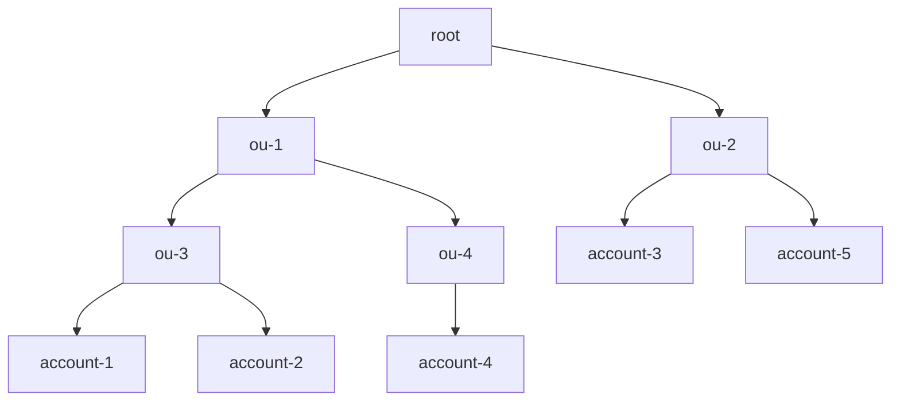

# AWS CloudFormation Construct Library


This module is part of the [AWS Cloud Development Kit](https://github.com/aws/aws-cdk) project.

## StackSets

The `StackSetStack` and `StackSet` constructs allow you to define [AWS CloudFormation StackSets](https://docs.aws.amazon.com/AWSCloudFormation/latest/UserGuide/what-is-cfnstacksets.html).

```ts
const stack = new Stack();
const stackSetStack = new StackSetStack(stack, 'MyStackSet');

new StackSet(stack, 'StackSet', {
  target: StackSetTarget.fromAccounts({
    regions: ['us-east-1'],
    accounts: ['11111111111'],
    parameterOverrides: {
      SomeParam: 'overrideValue',
    },
  }),
  template: StackSetTemplate.fromStackSetStack(stackSetStack),
});
```

### Creating a StackSet Stack

StackSets allow you to deploy a single CloudFormation template across multiple AWS accounts and regions.
Typically when creating a CDK Stack that will be deployed across multiple environments, the CDK will
synthesize separate Stack templates for each environment (account/region combination). Because of the
way that StackSets work, StackSet Stacks behave differently. For Stacks that will be deployed via StackSets,
a single Stack is defined and synthesized. Any environmental differences must be encoded using Parameters.

A special class was created to handle the uniqueness of the StackSet Stack.
You declare a `StackSetStack` the same way that you declare a normal `Stack`, but there
are a couple of differences. `StackSetStack`s have a couple of special requirements/limitations when
compared to Stacks.

*Requirements*
- Must be defined inside the stack of the StackSets that use it, directly or in a construct or nested
  stack of that stack
- Cannot reference resources of other stacks, and other stacks cannot reference its resources

*Limitations*
- Does not support Docker container assets
- Is always environment agnostic: its `account` and `region` are `AWS::AccountId` and `AWS::Region`,
  also inside a `Stage` with an environment
- Defining a deployable `Stack` inside a `StackSetStack` is not supported

The stack that contains the `StackSetStack` publishes its template as a file asset, and the `TemplateURL`
of the StackSet points to it. A `StackSetStack` that is not defined inside a stack fails with a
`StackSetStackMustBeDefinedWithinStack` error, and a StackSet in another stack, or in a nested stack,
fails with a `StackSetNotInStackOfStackSetStack` error. Several StackSets in the same stack can use one
`StackSetStack`. For StackSets in different stacks, define a `StackSetStack` in each of those stacks.

A `StackSetStack` is deployed into the target accounts and regions of its StackSets, where values of other
stacks cannot be resolved. Synthesis therefore fails with a `StackSetStackCrossStackReference` error when a
`StackSetStack` and another stack, including the stack that contains it, reference each other's resources
or depend on each other. When the other stack has an explicit environment, the error is the one the CDK
raises for references across environments. Pass such values as StackSet `parameters` instead.

Warnings, errors and info messages that constructs inside a `StackSetStack` report appear in the cloud
assembly artifact of the stack that contains it, under the path of the construct that reported them,
whether or not a StackSet uses it. Acknowledge a warning on the construct, the `StackSetStack` or any scope
that contains it, including that stack.

Once you create a `StackSetStack` you can create resources within the stack.
```ts
const stack = new Stack();
const stackSetStack = new StackSetStack(stack, 'StackSet');

new iam.Role(stackSetStack, 'MyRole', {
  assumedBy: new iam.ServicePrincipal('myservice.amazonaws.com'),
});
```

Or
```ts
class MyStackSet extends StackSetStack {
  constructor(scope: Construct, id: string) {
    super(scope, id);

    new iam.Role(this, 'MyRole', {
      assumedBy: new iam.ServicePrincipal('myservice.amazonaws.com'),
    });
  }
}
```

### Creating a StackSet

AWS CloudFormation StackSets enable you to create, update, or delete stacks across multiple accounts and AWS Regions
with a single operation. Using an administrator account, you define and manage an AWS CloudFormation template, and use
the template as the basis for provisioning stacks into selected target accounts across specific AWS Regions.

There are two methods for defining _where_ the StackSet should be deployed. You can either define individual accounts, or
you can define AWS Organizations organizational units.

#### Deploying to individual accounts

Deploying to individual accounts requires you to specify the account IDs. If you later want to deploy to additional accounts,
or remove the StackSet from accounts, add or remove the account ID in the list.

```ts
const stack = new Stack();
const stackSetStack = new StackSetStack(stack, 'MyStackSet');

new StackSet(stack, 'StackSet', {
  target: StackSetTarget.fromAccounts({
    regions: ['us-east-1'],
    accounts: ['11111111111'],
  }),
  template: StackSetTemplate.fromStackSetStack(stackSetStack),
});
```

#### Deploying to organizational units

AWS Organizations is an AWS service that enables you to centrally manage and govern multiple accounts.
AWS Organizations allows you to define organizational units (OUs) which are logical groupings of AWS accounts.
OUs enable you to organize your accounts into a hierarchy and make it easier for you to apply management controls.
For a deep dive on OU best practices you can read the [Best Practices for Organizational Units with AWS Organizations](https://aws.amazon.com/blogs/mt/best-practices-for-organizational-units-with-aws-organizations/) blog post.

You can either specify the organization itself, or individual OUs. By default the StackSet will be deployed
to all AWS accounts that are part of the OU. If the OU is nested it will also deploy to all accounts
that are part of any nested OUs.

For example, given the following org hierarchy



You could deploy to all AWS accounts under OUs `ou-1`, `ou-3`, `ou-4` by specifying the following:

```ts
const stack = new Stack();
const stackSetStack = new StackSetStack(stack, 'MyStackSet');

new StackSet(stack, 'StackSet', {
  target: StackSetTarget.fromOrganizationalUnits({
    regions: ['us-east-1'],
    organizationalUnits: ['ou-1'],
  }),
  template: StackSetTemplate.fromStackSetStack(stackSetStack),
});
```

This would deploy the StackSet to `account-1`, `account-2`, `account-4`.

If there are specific AWS accounts that are part of the specified OU hierarchy that you would like
to exclude, this can be done by specifying `excludeAccounts`.

```ts
const stack = new Stack();
const stackSetStack = new StackSetStack(stack, 'MyStackSet');

new StackSet(stack, 'StackSet', {
  target: StackSetTarget.fromOrganizationalUnits({
    regions: ['us-east-1'],
    organizationalUnits: ['ou-1'],
	excludeAccounts: ['account-2'],
  }),
  template: StackSetTemplate.fromStackSetStack(stackSetStack),
});
```

This would deploy only to `account-1` & `account-4`, and would exclude `account-2`.

Sometimes you might have individual accounts that you would like to deploy the StackSet to, but
you do not want to include the entire OU. To do that you can specify `additionalAccounts`.

```ts
const stack = new Stack();
const stackSetStack = new StackSetStack(stack, 'MyStackSet');

new StackSet(stack, 'StackSet', {
  target: StackSetTarget.fromOrganizationalUnits({
    regions: ['us-east-1'],
    organizationalUnits: ['ou-1'],
	additionalAccounts: ['account-5'],
  }),
  template: StackSetTemplate.fromStackSetStack(stackSetStack),
});
```

This would deploy the StackSet to `account-1`, `account-2`, `account-4` & `account-5`.

#### StackSet permissions

There are two modes for managing StackSet permissions (i.e. _where_ StackSets can deploy & _what_ resources they can create).
A StackSet can either be `Service Managed` or `Self Managed`.

You can control this through the `deploymentType` parameter.

##### Service Managed

When a StackSet is service managed, the permissions are managed by AWS Organizations. This allows the StackSet to deploy the Stack to _any_
account within the organization. In addition, the StackSet will be able to create _any_ type of resource.

```ts
const stack = new Stack();
const stackSetStack = new StackSetStack(stack, 'MyStackSet');

new StackSet(stack, 'StackSet', {
  target: StackSetTarget.fromOrganizationalUnits({
    regions: ['us-east-1'],
    organizationalUnits: ['ou-1'],
  }),
  deploymentType: DeploymentType.serviceManaged(),
  template: StackSetTemplate.fromStackSetStack(stackSetStack),
});
```

When you specify `serviceManaged` deployment type, automatic deployments are enabled by default.
Automatic deployments allow the StackSet to be automatically deployed to or deleted from
AWS accounts when they are added or removed from the specified organizational units.

##### Self Managed

When a StackSet is self managed (the default), you create the IAM roles StackSets uses. The
administration role is assumed by CloudFormation in the account the StackSet is deployed from,
and it assumes an execution role that must already exist in each target account.

If you don't pass an `adminRole`, the StackSet creates one. Its trust policy only allows
CloudFormation to assume it on behalf of StackSets in the same account, using the
`aws:SourceAccount` and `aws:SourceArn` condition keys to protect against the
[confused deputy problem](https://docs.aws.amazon.com/AWSCloudFormation/latest/UserGuide/stacksets-prereqs-self-managed.html).
If you pass in your own `adminRole`, the CDK does not add these conditions to its existing trust
policy, so you need to add them. The StackSet still grants the role permission to assume the execution
role. If the role is defined in your app and the StackSet targets opt-in regions, the StackSet also
adds a statement to its trust policy that allows the CloudFormation service principal of each opt-in
region to assume it, with the same conditions.

```ts
const stack = new Stack();
const stackSetStack = new StackSetStack(stack, 'MyStackSet');

new StackSet(stack, 'StackSet', {
  target: StackSetTarget.fromAccounts({
    regions: ['us-east-1'],
    accounts: ['11111111111'],
  }),
  deploymentType: DeploymentType.selfManaged({
    executionRoleName: 'MyStackSetExecutionRole',
  }),
  template: StackSetTemplate.fromStackSetStack(stackSetStack),
});
```

#### Using File Assets

The stack that contains the `StackSetStack` facilitates its file assets. Behind the scenes,
this is accomplished using the `BucketDeployment` construct from the
`aws_s3_deployment` module. You need to provide a list of buckets outside the scope of the CDK
managed asset buckets and ensure you have permissions for the target accounts to pull
the artifacts from the supplied bucket(s).

As a basic example, if using a `serviceManaged` deployment, you just need to give read
access to the Organization. You can create the asset bucket in the stack that contains the `StackSetStack`, or another
stack in the same app and pass the object as a prop. Or, import an existing bucket as needed.

If you create the bucket in that stack or a sibling stack, you could define it similar to this:

```ts
const bucket = new s3.Bucket(this, "Assets", {
  bucketName: "prefix-us-east-1",
});

bucket.addToResourcePolicy(
  new iam.PolicyStatement({
    actions: ["s3:Get*", "s3:List*"],
    resources: [bucket.arnForObjects("*"), bucket.bucketArn],
    principals: [new iam.OrganizationPrincipal("o-xyz")],
  })
);
```

Then pass as a prop to the StackSet stack:

```ts
declare const bucket: s3.Bucket;
const stack = new Stack();
const stackSetStack = new StackSetStack(stack, 'MyStackSet', {
  assetBuckets: [bucket],
  assetBucketPrefix: "prefix",
});
```

To facilitate multi-region deployments, there is an `assetBucketPrefix` property. This
gets added to the region the StackSet is deployed to. The stack synthesis for
the StackSet would look for a bucket named `prefix-{Region}` in the example
above. `{Region}` is whatever region you are deploying the StackSet to as
defined in the `target` property of the StackSet. You will need to ensure the
bucket name is correct based on what was previously created and then passed in.

You can use self-managed StackSet deployments with file assets too, but you will
need to ensure the roles in all target accounts have access to the central asset
bucket you pass as the property.

The StackSet waits for the asset copies to the buckets of its template to complete before it deploys.
If you pass an imported bucket, the CDK cannot add the bucket policy for you and emits a warning.
Once you have granted access yourself, acknowledge it with
`Annotations.of(stack).acknowledgeWarning('@aws-cdk/aws-cloudformation:stackSetAssetsBucketPermissions')`.

A nested stack inside a `StackSetStack` is a file asset too. Its template is published while the app is
prepared for synthesis, after aspects have run. If no other file asset created them earlier, the bucket
deployments that copy the template are created at that point, together with the deployment handler
function and its role, default policy and layer. Aspects, such as `Tags` or a permissions boundary, do not
apply to those constructs, and they cannot reference an asset bucket that another stack owns. Import the
asset bucket, or create it in the stack that contains the `StackSetStack`, in that case. If the deployment
handler must get your aspects, for example a mandatory permissions boundary, make it exist before the app is
prepared: give the `StackSetStack` a file asset of its own, such as Lambda code, or define a
`BucketDeployment` without memory, storage, VPC or security group settings in the stack that contains it.

### Importing an existing StackSet

You can reference a StackSet that was created outside of your app by its ID or by its ARN.
An imported StackSet has no `role`, and neither does a service managed StackSet.

```ts
const stack = new Stack();

const byId = StackSet.fromStackSetId(stack, 'ById', 'my-stackset:2f0a8b4c-1234-5678-9abc-def012345678');
const byArn = StackSet.fromStackSetArn(stack, 'ByArn',
  'arn:aws:cloudformation:us-east-1:111111111111:stackset/my-stackset:2f0a8b4c-1234-5678-9abc-def012345678');
```

The ID of a StackSet that you define in your app is available as `stackSetId`.

### Deploying StackSets using CDK Pipelines

You can also deploy StackSets using [CDK Pipelines](https://docs.aws.amazon.com/cdk/api/v2/docs/aws-cdk-lib.pipelines-readme.html).

Below is an example of a Pipeline that deploys from a central account. It also
defines separate stages for each "environment" so that you can first test out
the StackSet in pre-prod environments.

This would be an automated way of deploying the bootstrap stack described in
[this blog
post](https://aws.amazon.com/blogs/mt/bootstrapping-multiple-aws-accounts-for-aws-cdk-using-cloudformation-stacksets/).

```ts
declare const app: App;
interface BootstrapStageProps extends StageProps {
  readonly initialBootstrapTarget: StackSetTarget;
  readonly stacksetName?: string;
}

class BootstrapStage extends Stage {
  constructor(scope: Construct, id: string, props: BootstrapStageProps) {
    super(scope, id, props);

    const stack = new Stack(this, 'BootstrapStackSet');

    const bootstrap = new Bootstrap(stack, 'CDKToolkit');

    const stackSet = new StackSet(stack, 'StackSet', {
      template: StackSetTemplate.fromStackSetStack(bootstrap),
      target: props.initialBootstrapTarget,
      capabilities: [CfnCapabilities.NAMED_IAM],
      managedExecution: true,
      stackSetName: props.stacksetName,
      deploymentType: DeploymentType.serviceManaged({
        delegatedAdmin: true,
        autoDeployEnabled: true,
        autoDeployRetainStacks: false,
      }),
      operationPreferences: {
        regionConcurrencyType: RegionConcurrencyType.PARALLEL,
        maxConcurrentPercentage: 100,
        failureTolerancePercentage: 99,
      },
    });
  }
}


const pipeline = new pipelines.CodePipeline(this, 'BootstrapPipeline', {
  synth: new pipelines.ShellStep('Synth', {
    commands: [
      'yarn install --frozen-lockfile',
      'npx cdk synth',
    ],
    input: pipelines.CodePipelineSource.connection('myorg/myrepo', 'main', {
      connectionArn: 'arn:aws:codestar-connections:us-east-2:111111111111:connection/ca65d487-ca6e-41cc-aab2-645db37fdb2b',
    }),
  }),
  selfMutation: true,
});

const regions = [
  'us-east-1',
  'us-east-2',
  'us-west-2',
  'eu-west-2',
  'eu-west-1',
  'ap-south-1',
  'ap-southeast-1',
];

pipeline.addStage(
  new BootstrapStage(app, 'DevBootstrap', {
    env: {
      region: 'us-east-1',
      account: '111111111111',
    },
    stacksetName: 'CDKToolkit-dev',
    initialBootstrapTarget: StackSetTarget.fromOrganizationalUnits({
      regions,
      organizationalUnits: ['ou-hrza-ar333427'],
    }),
  }),
);

pipeline.addStage(
  new BootstrapStage(app, 'ProdBootstrap', {
    env: {
      region: 'us-east-1',
      account: '111111111111',
    },
    stacksetName: 'CDKToolkit-prd',
    initialBootstrapTarget: StackSetTarget.fromOrganizationalUnits({
      regions,
      organizationalUnits: ['ou-hrza-bb999427', 'ou-hraa-ar111127'],
    }),
  }),
);
```
